# PulseBridge

A Flutter app that talks to a medical device: an ECG monitor, or any Bluetooth heart-rate strap. Native Kotlin underneath, a written protocol, risk analysis and requirements traced to tests, the way a real medical-device app would be built.

No hardware needed: a **Python device simulator** streams ECG over a binary protocol, including **real patient recordings from the MIT-BIH Arrhythmia Database**, and can break on purpose (corrupted frames, dropped link, electrode off, flat battery, a firmware update that fails halfway). With Bluetooth, the app also connects to real heart-rate sensors.

> Portfolio project. Not a medical device, not for clinical use.

**▶ Try it in your browser: [margaridafpereira.github.io/pulsebridge](https://margaridafpereira.github.io/pulsebridge/)**
No install: the web version simulates the ECG device inside the page and plays real MIT-BIH ECG. Settings → *Try the safety features* drops the link or pulls an electrode off on demand. In Chrome or Edge it also connects to a real Bluetooth heart-rate strap.

| Live monitor | Symptom diary | Link lost |
|---|---|---|
| 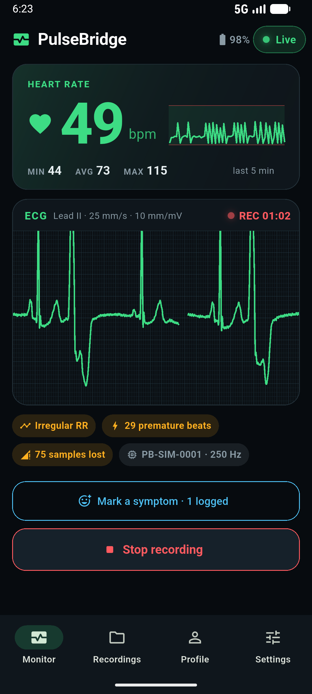 | 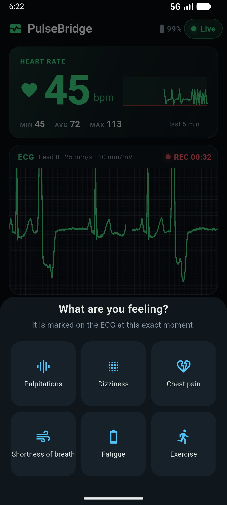 | 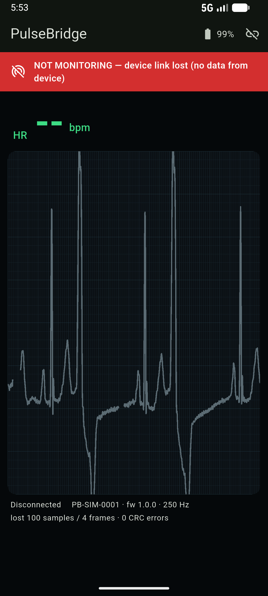 |
| **Recordings** | **Session review** | **Patient profile** |
| 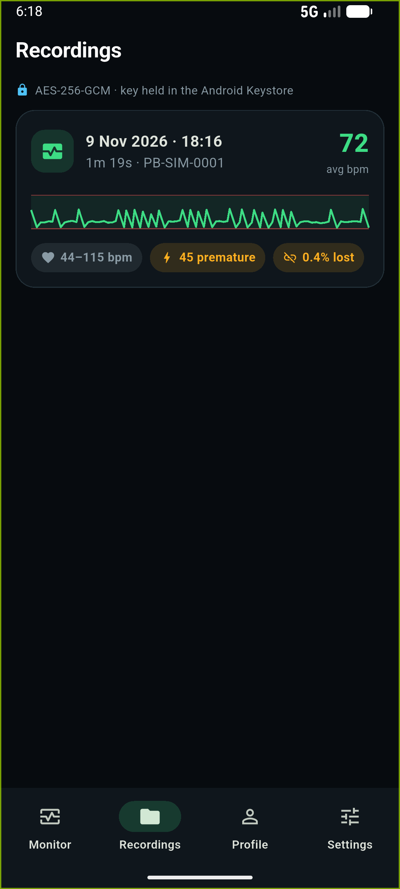 | 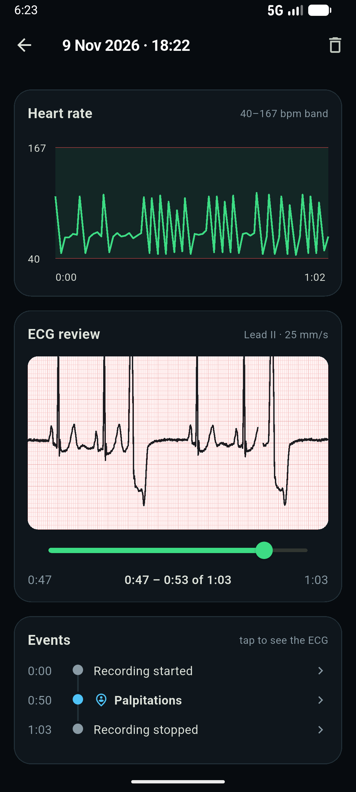 | 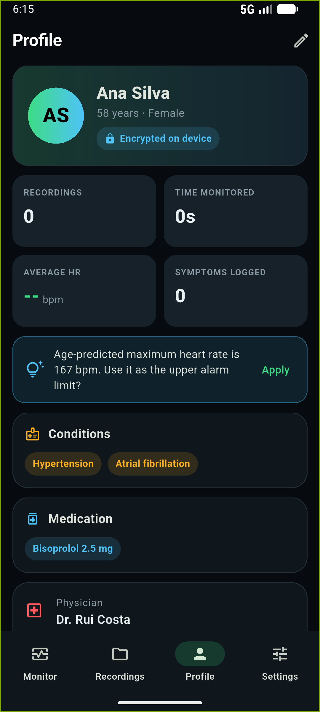 |
| **Clinician lock** | **PDF report** | **Report, printed** |
| 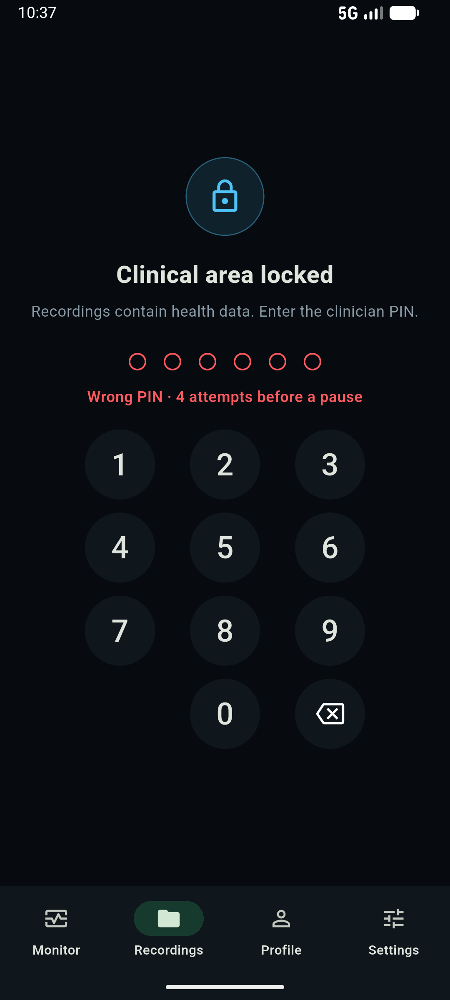 | 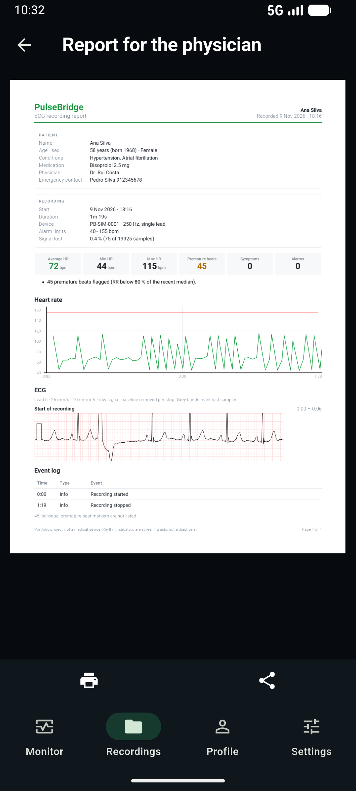 | 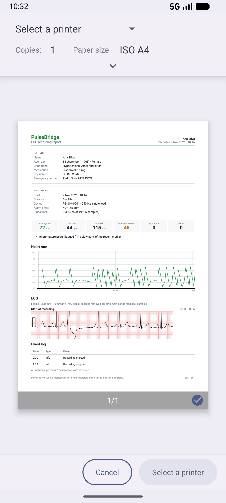 |
| **Em português, rate from the ECG** | **Firmware update** | **Bluetooth sensors** |
| 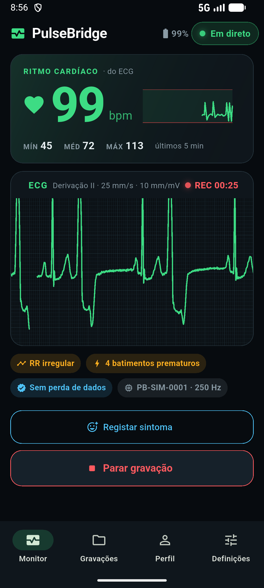 | 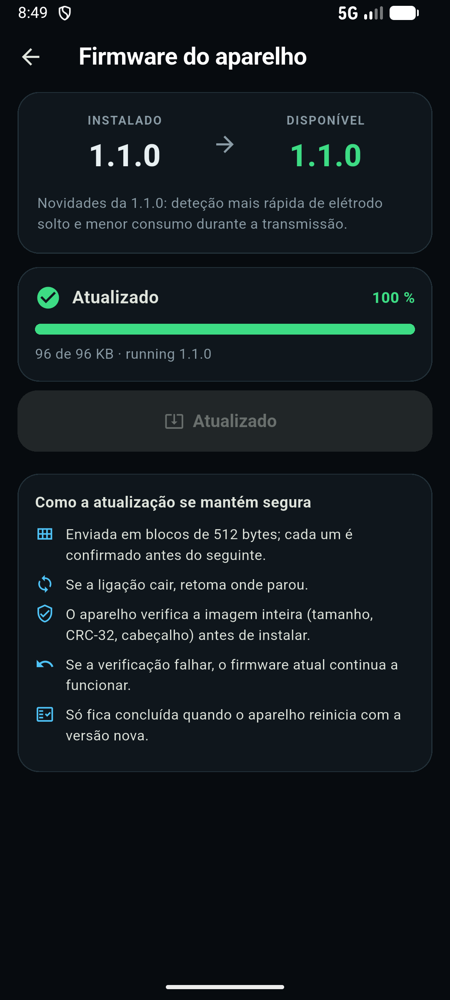 | 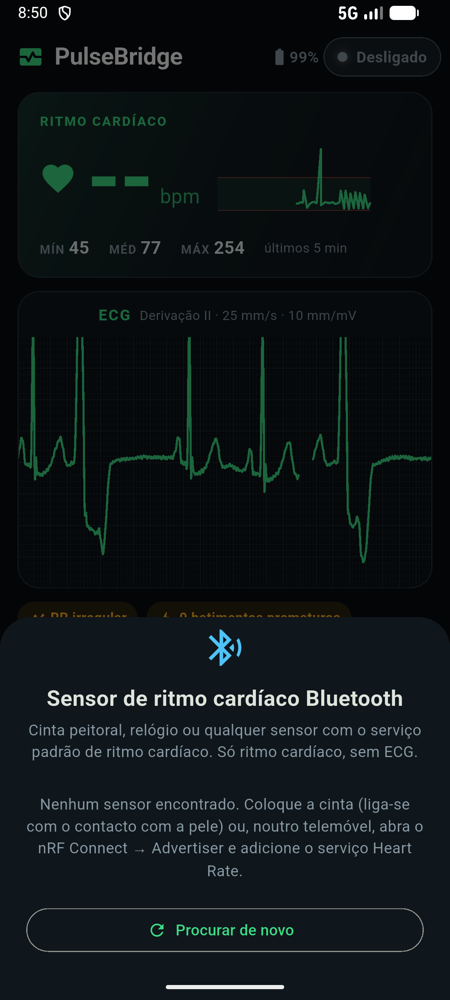 |
| **FHIR export** | **Bluetooth in Settings** | |
| 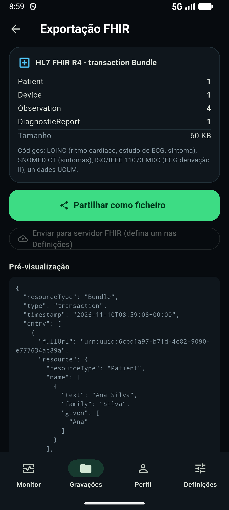 | 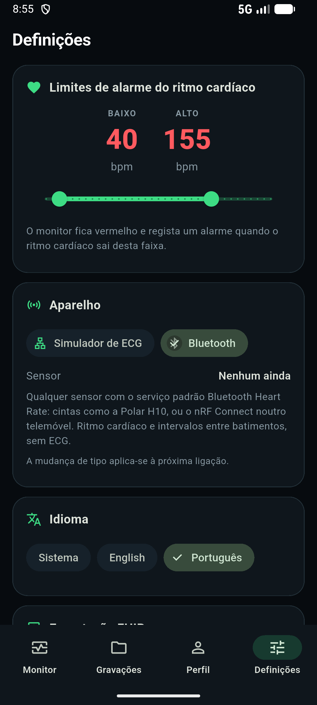 | |

Screenshots use real ECG from MIT-BIH record 119 (a patient with ventricular bigeminy). The firmware one was taken with the link dropping at 40 KB on purpose: it resumed and finished. The emulator has no Bluetooth sensors, hence "none found".

## What it does

**Monitoring**
- Live ECG on a standard paper grid, swept like a bedside monitor, with a 0.5 Hz baseline filter.
- Heart rate with a heart that beats along, a 5-minute trend and min / avg / max.
- **The phone finds the beats itself** (Pan-Tompkins) instead of trusting the device. Checked against the cardiologists' annotations: 99.2 % sensitivity, 99.8 % positive predictivity over MIT-BIH records 100, 119 and 201, atrial fibrillation included.
- Rhythm screening: premature beats and irregular RR intervals, always labelled as a hint, not a diagnosis.
- Symptom diary, Holter-style: tap "palpitations" and it's pinned to that second of the ECG.
- Keeps recording with the app closed (foreground service).

**When things go wrong**
- Lost samples are drawn as gaps, never as a smooth line.
- Link dropped or device gone quiet → big red **NOT MONITORING**, the heart rate disappears, and the app reconnects on its own.
- Electrode off and low-battery alarms.

**Two kinds of device, picked in Settings**
- **ECG simulator** over TCP: ECG, heart rate, alarms, firmware updates.
- **Bluetooth heart-rate sensor:** anything with the standard Heart Rate Service (Polar strap, watch, or nRF Connect pretending on another phone). Heart rate and beat intervals, no ECG. Same safety rules: no skin contact = "electrode off", silent sensor = link lost.

**Recordings and sharing**
- Every session saved with its raw ECG, heart rate and event log; scrub the ECG, tap an event to jump to it.
- **PDF report for the physician:** ECG strips at real paper scale (25 mm/s, 10 mm/mV) at each symptom and alarm, so they can be measured with a ruler.
- **FHIR R4 export:** the session as a standard health-data bundle (LOINC, SNOMED CT, ISO 11073 codes), shared as a file or sent to a FHIR server over https.

**Device firmware update**
- Installs firmware 1.1.0 on the ECG device in 512-byte chunks.
- Survives a dropped link (resumes where it stopped), refuses broken images (the device keeps its old version), and only says "done" when the device restarts with the new version. Never during a recording.

**Privacy**
- Everything encrypted on the phone (AES-256-GCM, key locked in the Android Keystore).
- Recordings, reports and exports sit behind a clinician PIN or fingerprint, with lockout after wrong PINs.

**For everyone**
- English and Portuguese (follows the phone, or pick in Settings), PDF included.
- TalkBack labels, alarms read out as they appear, works with text at 200 %, respects "reduce motion".

## Web vs Android

The same Flutter code runs in both. What changes is what sits underneath:

| | Android | Web demo |
|---|---|---|
| ECG device | Python simulator over TCP (or real hardware) | Simulated inside the page, same behaviour |
| Bluetooth sensors | Native Kotlin (GATT) | Web Bluetooth (Chrome, Edge; not iPhone) |
| Background recording | Foreground service | Only while the tab is open |
| Storage | AES-256-GCM, key in the Android Keystore | Browser localStorage, not hardware-encrypted (only simulated data) |
| Fingerprint | Yes | No, PIN only |
| Firmware update | Real protocol against the simulator | Same screens, simulated timing |

## Where the data lives

Only on the phone, in the app's private folder (`/data/data/pt.margaridapereira.pulsebridge/files/secure/`):

| File | What's in it |
|---|---|
| `session_<id>.json` | One recording: info, heart rate, events |
| `session_<id>.ecg` | Its raw ECG (int16 µV, 250 Hz) |
| `profile.json`, `settings.json` | Patient profile, app settings |
| `clinician.json` | PIN hash, salt, failed attempts |

All encrypted with a key that can't leave the Keystore, so copied files are useless. Uninstall the app and it's all gone. A report or FHIR export only leaves the phone when you share or send it.

## How it's built

```
simulator (Python) ──TCP, frames + CRC──┐
                                        ├─▶ device_link (Kotlin) ──channels──▶ app (Flutter)
BLE heart-rate sensor ──GATT 0x180D─────┘
```

- **`device_link/`**, a Flutter plugin in Kotlin (no third-party connectivity libraries):
  - `protocol/`: frame decoder with CRC and resync, firmware messages.
  - `session/`: TCP session (keep-alive, silence timeout, reconnect, lost-data detection) and the firmware updater.
  - `ble/`: Heart Rate Service parser, Bluetooth session, scanner.
  - `DeviceService`: foreground service. `storage/SecureStore`: encrypted files.
- **`app/`**, the Flutter UI (Riverpod):
  - `monitor/`: live view, QRS detector, rhythm analysis.
  - `clinical/`: PIN and fingerprint lock. `report/`: PDF. `fhir/`: FHIR export. `firmware/`: update screen.
  - `l10n/`: strings generated from one table (`tool/l10n_table.py`) so English and Portuguese can't drift apart.
- **`simulator/`**, the reference implementation of the protocol, with a bootloader for firmware updates.

More in [docs/architecture.md](docs/architecture.md).

## Tests

| Where | How many | What |
|---|---|---|
| Simulator (Python) | 41 | protocol, ECG, device behaviour, MIT-BIH reader, bootloader |
| Plugin (Kotlin, JUnit) | 44 | decoder against the simulator's frames, sessions, Bluetooth, firmware updater, encryption |
| Plugin + app (Dart) | 70 | UI, lock, PDF, FHIR, QRS validation on MIT-BIH, Portuguese, accessibility, large text, web demo device |

```bash
cd simulator && python -m unittest discover -s tests            # Python
cd device_link && flutter test                                  # Dart, plugin
cd app && flutter test                                          # Dart, app (QRS validation needs the MIT-BIH files)
cd app/android && ./gradlew :device_link:testDebugUnitTest      # Kotlin
```

## Run it

Needs Flutter 3.47+ (Dart 3.13), Python 3.10+ (standard library only) and an Android emulator or phone.

```bash
cd simulator
python -m pulsebridge_sim.mitbih 100 119 201        # once: downloads real ECG to simulator/data/
python -m pulsebridge_sim --record data/119         # terminal 1
cd app && flutter run                               # terminal 2
```

In the app: **Connect a device** → host `10.0.2.2` (the PC as the emulator sees it), port `7878` → **Start recording**.

- **On a real phone:** same Wi-Fi as the PC, start the simulator with `--host 0.0.0.0`, and use the PC's IP as host.
- **Bluetooth:** Settings → Device → Bluetooth, then Connect. No strap? nRF Connect on another phone → Advertiser → add the Heart Rate service.
- **Firmware update:** Settings → Device firmware → Install 1.1.0.

### Breaking things on purpose

```bash
python -m pulsebridge_sim --record data/119 --lead-off-every 20 --drop-rate 0.02 --corrupt-rate 0.02
python -m pulsebridge_sim --fw-drop-after 40000    # link drops mid-update: watch it resume
python -m pulsebridge_sim --fw-corrupt             # "flash error": update rejected, old version kept
python -m pulsebridge_sim --help                   # everything else
```

There's also a terminal monitor, if you want to see the raw stream (here with `--record data/119 --lead-off-every 20` on the simulator):

```bash
python -m pulsebridge_sim.monitor --seconds 30
```

```
hello: Hello(device_id='PB-SIM-0001', firmware='1.0.0', sample_rate=250)
heart rate: 68 bpm (RR 889 ms)
heart rate: 111 bpm (RR 539 ms)     ← a premature beat in record 119…
heart rate: 46 bpm (RR 1317 ms)     ← …and its compensatory pause
alarm: LEAD_OFF ON
```

The ECG data comes from Moody GB and Mark RG, *The impact of the MIT-BIH Arrhythmia Database*, IEEE EMB 20(3), 2001, via [PhysioNet](https://physionet.org/content/mitdb/1.0.0/) (ODC-By 1.0).

## The paperwork

Shaped after IEC 62304, ISO 14971 and IEC 62366, the standards a real medical-device app would follow, but written to be readable:

- [Architecture](docs/architecture.md): the picture and why it's built this way
- [Device protocol](docs/protocol.md): every byte, including the firmware update
- [Requirements](docs/requirements.md): what it has to do
- [Risk analysis](docs/risk-analysis.md): what could go wrong and what we did about it
- [Traceability](docs/traceability.md): which test proves which requirement
- [Usability](docs/usability.md): who uses it, accessibility, interface risks

## Not done yet

- Try the Bluetooth path with a real strap, and the fingerprint on a real phone.
- Firmware images are checked for integrity (CRC-32), not signed. A real device would verify a signature.
