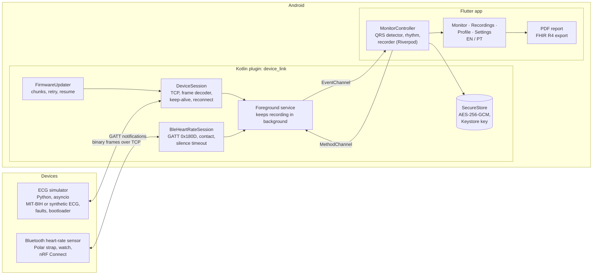

# Architecture

## Why it's built like this

- **The device link lives in Kotlin, not Dart.** Recording has to keep going when Android kills the Flutter UI. Transport, parsing and the foreground service all sit on the native side, so they don't care whether the Flutter engine is alive.
- **One interface, two kinds of device.** `DeviceHub` holds a `DeviceConnection`, which is either the TCP session (the ECG simulator) or the Bluetooth session (a heart-rate sensor). The Flutter side sees the same events either way; it only notices that a BLE sensor sends no ECG.
- **Same safety rules for both.** Silence for too long counts as a lost link, the session reconnects with backoff, and "electrode off" (or "no skin contact" on BLE) hides the heart rate instead of showing a stale number.
- **The phone computes its own heart rate.** When ECG is streaming, the app runs Pan-Tompkins on it and ignores the device's number. Two independent sources is the point: the device can't silently get it wrong. Without ECG (BLE), the sensor's value is used, and the screen says which source it is.
- **The simulator is the reference implementation.** The protocol is written down in [protocol.md](protocol.md), built first in Python with tests, and the Kotlin decoder has to decode the simulator's frames byte for byte.
- **Faults are a feature.** The simulator can drop frames, corrupt bytes, cut the link, raise alarms, drop the link mid-update and "corrupt flash", so every hazard in [risk-analysis.md](risk-analysis.md) can be reproduced on demand.
- **Firmware updates never trust the link.** Stop-and-wait with retries, resume after a drop, verification on the device before switching, and "done" only when the device comes back with the new version.
- **Stored data stays in English.** Event texts and symptoms are saved as English keys and translated on screen, so a recording reads the same on any phone. Codes in the FHIR export (LOINC, SNOMED CT, MDC) don't depend on language at all.
- **Nothing leaves the phone by itself.** Everything is encrypted at rest; a PDF or FHIR export only goes out when someone taps share or send, and sending needs https and a confirmation.
